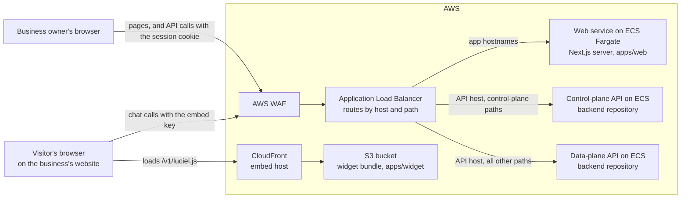

# Luciel — Frontend

Luciel, by VantageMind, is an AI front-desk employee for small businesses. It answers a
business's customers on its website and other channels from the business's own knowledge,
hands the conversation to the team when it cannot answer confidently, and gives the owner a
dashboard to run it. This repository is the browser-facing half of the product: the marketing
site, sign-up and the owner dashboard (one Next.js app), the chat widget that businesses embed
on their own websites, and the typed API client, UI kit and design tokens those apps share. The
API, the AI runtime and the AWS infrastructure live in the companion Luciel-Backend repository.

## Highlights

- **Two API planes, kept apart down to the shipped bundle.** The dashboard calls the
  control-plane (admin) API through `@luciel/api-client` with an httpOnly session cookie; the widget
  calls the public data-plane API through `@luciel/api-client/widget` with an embed key and no
  cookies. A [scan of the built bundle](apps/widget/scripts/check-bundle.mjs) fails the widget
  build if admin-API symbols or paths turn up in it, and a
  [source-level test](packages/api-client/src/__tests__/plane-separation.test.ts) fails the unit
  tests if the widget's entry point exports the admin client.
- **One typed client, two adapters.** Components depend only on the `LucielApiClient` interface,
  whose response shapes come from Zod schemas. One flag picks the HTTP adapter or a stateful mock
  with account states, injected failures and slow calls, so the dashboard runs and is tested end
  to end without a backend. ESLint keeps UI code away from the adapters, and a production build
  with the flag unset uses HTTP ([`lib/api.ts`](apps/web/src/lib/api.ts)).
- **Honest states as a tested contract.** A connection reads Connected, Action needed, Reconnect
  needed or Not available yet ([`chips.ts`](packages/api-client/src/chips.ts)), never a false
  Connected. Answer evidence tells four cases apart: sources used, none found, search unavailable,
  attribution not recorded. A failed confirmation keeps its dialog open with the error
  ([`Modal.test.tsx`](packages/ui/src/Modal.test.tsx)); lists keep loading, empty and error apart.
- **Long-running knowledge syncs without hung requests.** A website crawl can outlast the load
  balancer's 60 s idle timeout, so the API answers 202 once a sync runs past 20 s, and the client
  polls the job ([`sync-job.ts`](packages/api-client/src/adapters/sync-job.ts)) every 2 s for up to
  10 minutes, matching its own job by start time and telling "still running" apart from "failed".
  The dashboard frees the button at the 202 and refreshes the list while the source syncs.
- **A widget that behaves on someone else's page.** One self-initialising script in plain
  TypeScript and DOM ([`mount.ts`](apps/widget/src/mount.ts)). It mounts in a Shadow DOM, pins its
  position with inline styles on the host element, refuses plain-HTTP pages (except localhost),
  renders nothing while the business has paused Luciel or switched website chat off, keeps one
  conversation across page navigations, and picks up staff replies by polling. Assistant markdown
  goes through an escape-first renderer with a tag allowlist
  ([`markdown.ts`](packages/ui/src/markdown.ts)); visitor text stays a text node.
- **Strict browser security.** A nonce-based [Content Security Policy](apps/web/src/middleware.ts)
  with `frame-ancestors 'none'`, [HSTS and related headers](apps/web/next.config.mjs), and a session
  token held in an httpOnly cookie that browser code never reads.
- **Fail-closed supply-chain gates with expiring waivers.** The [audit gate](scripts/audit-gate.mjs)
  and the [image CVE gate](scripts/image-scan-gate.mjs) block HIGH and CRITICAL findings, fail when
  their input is missing or unreadable, and fail once a waiver expires while its finding remains.
  [Workflow tests](scripts/workflow-gates.test.mjs) pin the deploy order: gate the image, then
  promote it. Waivers live in [`.security/`](.security) with a reason and an expiry.
- **Tests that walk the product like a customer.** Playwright runs axe-core's WCAG 2.1 AA rules
  ([`a11y.spec.ts`](apps/web/tests/e2e/a11y.spec.ts)) on all 23 routes and fails when a new page
  has no entry; seven suites, one per account state, re-read every write after a reload; a
  [scripted walk](apps/web/tests/e2e/walk/customer-walk.spec.ts) covers every dashboard page. The
  same walk runs against a deployed environment from a manually dispatched workflow, writing only
  to a dedicated test account and skipping, with reasons, steps that need real third-party services.

## Architecture



- **Web app ([`apps/web`](apps/web)).** One Next.js App Router app: `(marketing)` holds the home,
  contact, embed-preview and legal pages, `(auth)` sign-up, verification, login and password
  reset, and `(app)` first-run setup and the dashboard (overview, configuration, embedding,
  conversations with evidence and human takeover, leads, billing, analytics, audit log, account
  lifecycle). Dashboard pages fetch from the API in the browser with TanStack Query. The root
  layout is `force-dynamic` so every response carries a fresh CSP nonce, which is why the app
  runs as a Node server rather than as a static export.
- **Widget ([`apps/widget`](apps/widget)).** A business adds one tag to its site; the script
  reads the public embed key from `data-key` at runtime, mounts itself and talks only to the
  data plane:

  ```html
  <script src="https://embed.vantagemind.ai/v1/luciel.js" data-key="vm_live_..."></script>
  ```

- **Backend (separate repository).** The API runs in ca-central-1 as two ECS services behind one
  load balancer per environment: a control plane for the dashboard and account API (including
  sign-up, login and the contact form) and a data plane for the widget and channel webhooks. The
  backend's AWS CDK app also defines the web service, its ECR repository, the widget bucket and
  the CloudFront distribution; this repository builds and ships the artifacts.

## Tech stack

| Area                   | Choices                                                                                                   |
| ---------------------- | --------------------------------------------------------------------------------------------------------- |
| Language and workspace | TypeScript (strict), pnpm 9 workspaces, Node.js 22+                                                       |
| Web app                | Next.js 15 (App Router), React 19, TanStack Query, React Hook Form with Zod, Radix UI, Tailwind CSS 3     |
| Widget                 | Vite 6 library build (IIFE and ES module), plain DOM, Shadow DOM                                          |
| API boundary           | Zod schemas, a `fetch` transport with typed errors, HTTP and mock adapters                                |
| Testing                | Vitest, Testing Library, jsdom, Playwright, axe-core                                                      |
| Quality and security   | ESLint (`next/core-web-vitals`), Prettier, gitleaks, `pnpm audit` gate, ECR image-scan gate               |
| Delivery               | Docker (Node 22 on Debian slim, non-root), GitHub Actions with AWS OIDC, ECR, ECS Fargate, S3, CloudFront |

## Repository layout

| Path                                            | Contents                                                                                                                                                                              |
| ----------------------------------------------- | ------------------------------------------------------------------------------------------------------------------------------------------------------------------------------------- |
| `apps/web/src/app/`                             | App Router route groups `(marketing)`, `(auth)` and `(app)`, plus the error pages                                                                                                     |
| `apps/web/src/components/`, `apps/web/src/lib/` | Dashboard components (`config/` holds the Configure page's sections), API wiring, query hooks, sync and crash-recovery helpers                                                        |
| `apps/web/src/middleware.ts`                    | Per-request CSP and the signed-out redirect for dashboard routes                                                                                                                      |
| `apps/web/tests/`                               | Vitest unit tests (`unit/`) and Playwright suites (`e2e/`)                                                                                                                            |
| `apps/web/Dockerfile`                           | Multi-stage production image, built from the repository root                                                                                                                          |
| `apps/widget/`                                  | The widget: `src/mount.ts` (mount, chat loop, polling), `src/styles.ts` and `scripts/check-bundle.mjs`                                                                                |
| `packages/api-client/`                          | Zod schemas, the `LucielApiClient` and `WidgetApiClient` interfaces, HTTP and mock adapters, connection-chip mapping                                                                  |
| `packages/ui/`                                  | Shared accessible React primitives (`Modal`, `StatusChip`, `Field` and others) and the safe markdown renderer                                                                         |
| `packages/design-tokens/`                       | Design tokens as TypeScript, CSS custom properties and a Tailwind preset                                                                                                              |
| `scripts/`                                      | Supply-chain scripts: `audit-gate.mjs` (the CI dependency-audit gate), `image-scan-gate.mjs` (the deploy's image CVE gate), `allowlist-expiry.mjs` (the monthly waiver-expiry report) |
| `scripts/*.test.mjs`                            | Node tests for the image gate, the Dependabot classifier and the workflows                                                                                                            |
| `.security/`                                    | Dated, reasoned waivers for the dependency audit and the image CVE gate                                                                                                               |
| `.github/`                                      | Workflows (CI, deploy, live checks, scheduled maintenance) and the Dependabot configuration                                                                                           |

## Local development

Requirements: Node.js 22 or later (CI and the production image both use Node 22) and pnpm 9.7.0,
pinned in `package.json` and provided by Corepack (on Node.js 25+, run `npm install -g corepack`).

```bash
corepack enable && corepack prepare pnpm@9.7.0 --activate
pnpm install --frozen-lockfile
pnpm dev    # web app on http://localhost:3000; widget's Vite dev server on http://localhost:5173
```

With no configuration, both apps run against the mock adapters, so no backend is needed. Sign in
at `/login` with any email address and password. Add `?mock_scenario=<name>` to a URL to put the
account in another state (for example `fresh`, `paused` or `closed`) and `?mock_reset=1` to start
over; the dashboard's mock keeps its data in `sessionStorage`, so writes survive a reload.

| Variable                        | Read by      | Purpose                                                                              |
| ------------------------------- | ------------ | ------------------------------------------------------------------------------------ |
| `NEXT_PUBLIC_API_ADAPTER`       | `apps/web`   | `mock` or `http`; defaults to `mock` in development and `http` in a production build |
| `NEXT_PUBLIC_API_BASE_URL`      | `apps/web`   | API origin for the `http` adapter, also allowed in the CSP's `connect-src`           |
| `NEXT_PUBLIC_MOCK_SCENARIO`     | `apps/web`   | The build's default mock scenario (`verified` when unset)                            |
| `NEXT_PUBLIC_HCAPTCHA_SITE_KEY` | `apps/web`   | Public hCaptcha site key for the contact form; hCaptcha's test key when unset        |
| `VITE_WIDGET_ADAPTER`           | widget build | `mock` (the default) or `http`                                                       |
| `VITE_WIDGET_API_BASE_URL`      | widget build | Data-plane API origin compiled into the bundle                                       |

Next.js reads its variables from `apps/web/.env.local`; the widget build reads its two from the
shell environment. [`.env.example`](.env.example) is a template for all six (the mock scenario
commented out). Every one of them is compiled into a public bundle, so none may hold a secret.

To build the production web image locally, pass the adapter build arguments from the repository
root, as the deploy workflow does:

```bash
docker build -f apps/web/Dockerfile \
  --build-arg NEXT_PUBLIC_API_ADAPTER=http \
  --build-arg NEXT_PUBLIC_API_BASE_URL=<api-origin> \
  -t luciel-web .
```

Without them the image runs the mock adapter: the Dockerfile passes an unset build argument to
`next build` as an empty string, which bypasses the HTTP default.

## Tests and quality checks

```bash
pnpm -r typecheck                 # TypeScript, every package
pnpm -r test                      # Vitest unit tests, every package
pnpm -r build                     # production builds; the widget build runs the bundle check
pnpm --filter @luciel/web lint    # ESLint
pnpm format                       # Prettier check (CI runs it; pnpm format:write fixes)
pnpm test:scripts                 # Node tests: image CVE gate, Dependabot classifier, workflow rules
pnpm test:e2e                     # Playwright against the mock adapter (starts the dev server)
```

Playwright needs a browser once: `pnpm --filter @luciel/web exec playwright install chromium`.
To run one project: `pnpm --filter @luciel/web exec playwright test --project=walk`.

| Suite                                                  | Tests (counted 2026-11-13) | What it covers                                                                                                                          |
| ------------------------------------------------------ | -------------------------: | --------------------------------------------------------------------------------------------------------------------------------------- |
| Web app unit (`apps/web/tests/unit/`)                  |                        473 | Pages and components: states, counts, labels, modals and copy rules                                                                     |
| API client unit (`packages/api-client/src/__tests__/`) |                        142 | Transport, adapters and the mock runtime, plane separation, the sync-job poll                                                           |
| Widget unit (`apps/widget/src/mount.test.ts`)          |                         41 | Mounting, disclosure, sessions, polling, ending a chat, safe rendering                                                                  |
| UI kit unit (`packages/ui/src/`)                       |                         20 | `Modal`, `StatusChip`, `Logo` and the markdown renderer                                                                                 |
| Gate and workflow tests (`scripts/*.test.mjs`)         |                         42 | The CVE gate, the Dependabot classifier, workflow triggers and step order                                                               |
| Playwright `chromium` project                          |                         30 | WCAG 2.1 AA on all 23 routes, crash-page recovery, route coverage, the journey from overview to billing                                 |
| Playwright `scenario-*` projects                       |                          7 | One account state each: new, at its conversation cap, pay-as-you-go, paused, deleted within its restore window, closed, expired session |
| Playwright `walk` project                              |                          1 | The customer-style walk through every dashboard area, with timings in the report                                                        |

`live-smoke` (read-only) runs only with `E2E_LIVE=1`, and `live-walk` only with `E2E_LIVE=1` plus
`E2E_LIVE_WRITE=1`, against a deployed environment. CI ([`ci.yml`](.github/workflows/ci.yml))
runs on every pull request, every push to `main` and daily: the audit gate, script tests,
typecheck, unit tests, lint, formatting and every build (the widget's build includes the bundle
check), then the 38 Playwright tests above, plus a gitleaks secret scan.

## Deployment and operations

Deploys run only when a person dispatches [`deploy.yml`](.github/workflows/deploy.yml) from
`main`; a push deploys nothing.

```bash
gh workflow run deploy.yml --ref main -f environment=dev
```

1. **Guard.** Refuses any ref other than `main` before the first AWS call.
2. **Build.** Assumes the environment's deploy role through GitHub OIDC (no stored AWS keys),
   builds the widget and the web image, and pushes the image under its commit SHA.
3. **CVE gate.** Waits for ECR's scan-on-push result and runs the image gate on it; an incomplete
   scan, an unwaived HIGH or CRITICAL finding or an expired waiver stops the deploy.
4. **Promote and roll.** Promotes only the gated image to `latest`, the tag the web task runs,
   and redeploys the web service; a missing image fails the job.
5. **Widget.** Syncs the bundle to S3 under `/v1/`, gives the fixed-URL entrypoints a UTF-8
   charset and a five-minute must-revalidate cache, and invalidates CloudFront.
6. **Wait.** The job waits for the ECS roll to finish and fails if it takes over 10 minutes.

There is no separate rollback job: a refused image never becomes `latest`, a roll that does not
settle fails the run, and the web service's ECS deployment circuit breaker has rollback turned
on (backend CDK app). A `prod` deploy needs its own `environment=prod` dispatch and leaves dev
alone. Web containers log to CloudWatch, the service scales on CPU and memory, and the backend's
load-balancer alarms (5xx responses generated by the load balancer, p95 target response time)
also cover web-tier requests.

| Workflow                                | Trigger                                                  | What it does                                                                                                                         |
| --------------------------------------- | -------------------------------------------------------- | ------------------------------------------------------------------------------------------------------------------------------------ |
| `ci.yml`                                | Pull requests, pushes to `main`, daily at 06:23 UTC      | The checks above; the daily run keeps the audit and the secret scan current                                                          |
| `image-rebuild.yml`                     | Mondays at 07:45 UTC                                     | Rebuilds the web image from `main`, runs the CVE gate in report mode and posts the result to the month's review issue; never deploys |
| `dependency-review.yml`                 | The 1st of each month, 02:00 UTC                         | Audit, outdated packages and waivers expiring within 35 days, filed as the month's "Dependency & CVE review" issue                   |
| Dependabot, `dependabot-auto-merge.yml` | Weekly on Mondays; the merge check runs when CI finishes | npm, GitHub Actions and base-image updates; a green minor or patch update is squash-merged, a major is labelled for a person         |
| `live-smoke.yml`, `live-walk.yml`       | Manual dispatch only                                     | The live Playwright projects; the walk also requires the input `confirm=walk-account-only`                                           |

## Project status

Luciel is deployed to a development environment on AWS and has been verified there end to end:
on 2026-11-02 the customer walk passed against the deployed dashboard, with the steps that need
a real card, phone number, mailbox or third-party sign-in skipped and reported.

## Further reading

The `CLAUDE.md` files are each module's working guide for contributors and coding agents. Comments
cite design documents (`Arch §`, `Space Instructions §`), audit and work-package ids (`F0xx`,
`Pn-x`, `round N WP-x`, `Harmony wave N`) and owner decisions (`Dn`) kept outside the repository.

| Guide                                                                  | Covers                                                                                  |
| ---------------------------------------------------------------------- | --------------------------------------------------------------------------------------- |
| [`CLAUDE.md`](CLAUDE.md)                                               | Cross-cutting product rules, branch discipline, commands and deploy notes               |
| [`apps/web/CLAUDE.md`](apps/web/CLAUDE.md)                             | Dashboard key files and invariants, the Playwright suites, known pitfalls               |
| [`apps/widget/CLAUDE.md`](apps/widget/CLAUDE.md)                       | The widget contract: mounting, sessions, paused states, polling, the bundle gate        |
| [`packages/api-client/CLAUDE.md`](packages/api-client/CLAUDE.md)       | The API boundary, plane separation, the mock runtime and the asynchronous sync protocol |
| [`packages/ui/CLAUDE.md`](packages/ui/CLAUDE.md)                       | Shared primitives and their accessibility and async rules                               |
| [`packages/design-tokens/CLAUDE.md`](packages/design-tokens/CLAUDE.md) | The token system shared by the dashboard and the widget                                 |
| [`.security/audit-allowlist.md`](.security/audit-allowlist.md)         | The reasoning behind each dependency-audit waiver                                       |

## License

This code is proprietary and shared for portfolio review only. All rights reserved.
